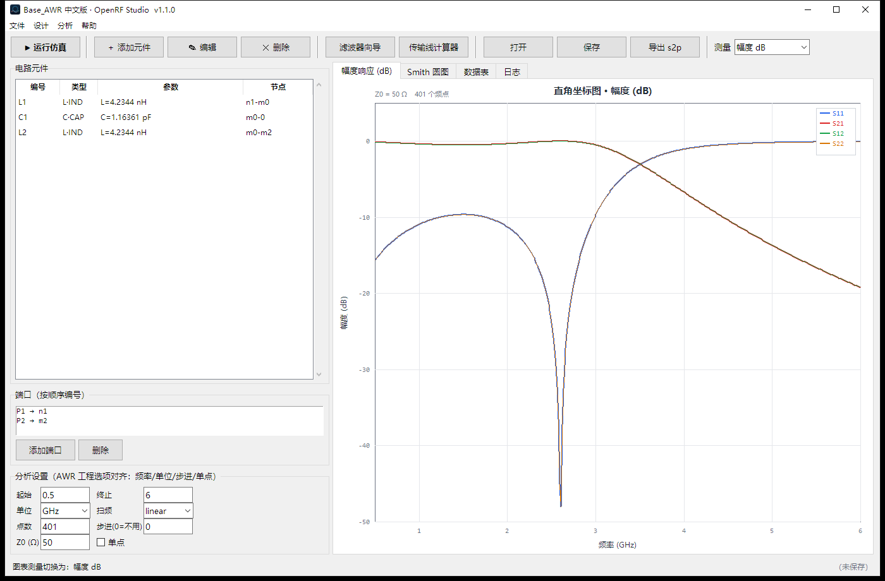

# OpenRF Studio 射频工作台

> 独立实现的射频/微波电路分析与综合工具：从元件参数到 S 参数、图表、原理图与文件交换。
> 不含任何商业软件的代码、资源或数据；公式取自公开教材与公开标准。



## 功能

| 模块 | 内容 |
|---|---|
| 电路描述 | 电阻 / 电感 / 电容 / 理想传输线 / 微带线 / 同轴线；任意节点拓扑；任意端口数 |
| 求解引擎 | 节点导纳矩阵 + Schur 消元 + S 参数（任意 N 端口，统一参考阻抗） |
| 分析 | 线性/对数扫频；频率单位 GHz/MHz/kHz；步进或点数；单点 |
| 图表 | 直角坐标图（幅度/驻波比/群时延/回损）、**回损曲线**、**增益表**、史密斯圆图、数据表、日志；**运行后动态播放**（光标扫描+实时读数） |
| **原理图** | 按网表自动布局画电路图（串联元件画在连线上、并联元件向下接地） |
| 综合 | 切比雪夫/巴特沃斯低通、带通 LC 梯形网络；微带线 Z0↔线宽 |
| **反向计算** | LC 谐振反求、改频微调（求要换的元件）、L 型阻抗匹配、由 S11 反算所需电抗 |
| **匹配计算器**（v1.4） | 单枝节（并联/串联、开路/短路）与 L 型匹配；解析求解线长与枝节长度，一键应用到电路并仿真 |
| **Smith 图交互**（v1.4） | 悬停/点击读数：频率、Γ、Zin=R+jX、VSWR、回波损耗；左键标记、右键取消 |
| **S2P 元件**（v1.4） | 导入 2 端口 Touchstone 作为元件，按频点插值 S→Y 参与全网求解 |
| **界面主题**（v1.6） | 浅色/深色（黑白）一键切换；标题栏、按钮、表格、圆图与曲线同步换色 |
| **Smith 工作台（合并）** | 单一「史密斯圆图」页签：Γ↔Z/Y 读数、VSWR/回波损耗/失配损耗、等 r/x/g/b 圆与波长图带、缩放/平移、叠加仿真 S11；**拖动圆内点即改变负载并实时重建电路 + 仿真**（180 ms 防抖，可关）；L 型匹配最多 4 解、一键落地；导出 SVG（见 [docs/合规与来源审核.md](docs/合规与来源审核.md)） |
| **1:4 巴伦（balun，平衡-不平衡变换）** | 威尔金森（Wilkinson）分配 + 两级四分之一波长（λ/4）变换 + 两段 λ/4 移相；50 Ω 转差分 200 Ω；中心 |S21|=|S31|=-3.01 dB（分贝）、相位差 180° |
| **AI 辅助设计**（v1.3） | 自然语言下指令；**可自动调用软件全部功能**（改电路/跑仿真/计算器/开工具/切页签/保存导出），执行结果回流后自动分析建议（≤3 轮）；模型可自定义为任意 OpenAI 兼容端点；也可切人工确认模式；未配置模型时用本地规则 |
| 传输线计算 | 微带 / 带状线 / 同轴：Z0↔尺寸双向、λ/4、电长度；mm/mil；基板预设 |
| 数据 | 工程 JSON；Touchstone (.sNp) 读写（MA/DB/RI，Hz/kHz/MHz/GHz） |
| 界面 | 全新圆图工作台 + 浅色/深色主题切换（视图菜单或标题栏按钮）；全中文，零第三方依赖，带多尺寸 ICO 图标 |

## 快速开始

```bat
:: 免安装 exe
dist\OpenRF_Studio\OpenRF_Studio.exe

:: 源码运行（Python 3.10+，仅标准库）
python run.py
:: 或双击
启动.cmd
```

启动后自动载入示例并完成一次仿真；界面默认停在「直角坐标图」，可切换「原理图」查看电路图。

命令行：

```bash
python -m app.cli demo
python -m app.cli synth 3 3e9
python -m app.cli microstrip 50 0.508 3.55 --quarter --f 2.4e9
python -m app.cli run examples/02_bandpass_2g4.json -o out.s2p
```

## 示例工程（examples/）

| 文件 | 内容 | 关键结果 |
|---|---|---|
| `01_lowpass_3ghz` | 3 阶切比雪夫低通 fc=3GHz | 通带纹波 0.5 dB，4.5GHz 抑制 >40 dB |
| `02_bandpass_2g4` | 3 阶带通 2.3–2.7 GHz | 中心插损 -0.01 dB，S11 -27.6 dB |
| `03_wilkinson_2ghz` | 三端口 Wilkinson 功分器 | 2GHz 等分 -3.01 dB，S11 < -130 dB |
| `04_microstrip_qw` | FR4 50Ω 微带 λ/4 线 | S11 < -100 dB，W=1.1455 mm |
| `05_coax_50ohm` | 50Ω 同轴线（100 mm） | S11 = 0，群时延 0.4834 ns |

## 测试

```bash
python -m tests.test_engine        # 解析解对拍：R/C/传输线/λ4/Wilkinson/滤波器
python -m tests.test_io            # Touchstone 往返、工程存取、带通、微带
python -m tests.test_topology      # 1..6 阶低通 / 1..4 阶带通拓扑回归
python -m tests.test_ui_logic      # 界面链路：向导→生成→仿真→表格/绘图
python -m tests.test_conformance   # 单位/传输线/目录/反向计算/原理图/品牌审计
python -m tests.test_ai            # AI 配置/客户端/协议/动作应用/本地规则/界面
python -m tests.test_s2p           # S2P 元件：加载/插值/S→Y/错误处理/缓存
python -m tests.test_match_ui      # 匹配对话框应用 + Smith 图悬停/标记
```

实测要点：滤波器与闭式响应最大偏差 **0.0005 dB**；同轴任意尺寸与解析式误差 **<1e-9**；
L 型匹配用引擎验证 **|S11| < 1e-16**；Touchstone 往返误差 **~1e-9**。

## 目录结构

```
app/
  complexmath.py   复数矩阵
  components.py    元件模型（R/L/C/TL/MS/COAX）
  engine.py        MNA → S 参数、扫频、指标
  synthesis.py     滤波器综合 / 微带辅助
  tline.py         传输线计算（微带/带状线/同轴）
  inverse.py       反向计算（LC 反求、改频、匹配、S11 反算）
  smith.py         史密斯图计算（Γ↔Z/Y、圆族、传输线、L 型匹配）
  units.py         单位换算
  catalog.py       元件目录 / 测量项目录 / 术语表
  builders.py      综合结果 → 网络（统一拓扑装配）
  touchstone.py    Touchstone 读写
  project.py       工程 JSON
  cli.py           命令行
  ai/              AI 辅助（config / client / assistant / actions）
  ui/              界面（app / dialogs / plots / smith_tool / schematic / ai_panel）
tests/             引擎、IO、拓扑、界面、一致性测试
examples/          示例工程与数据
tools/             示例与图标生成脚本
docs/              用户手册、架构与算法、功能规格验证、边界与路线图、AI 辅助设计
assets/            图标（openrf.ico 多尺寸 + PNG）
```

## 边界

本工具面向**集总/准静态**的快速设计与教学：没有全波电磁求解、谐波平衡、版图与设计规则检查、
器件模型库与优化器。详细能力对照与开发计划见 [docs/功能边界与路线图.md](docs/功能边界与路线图.md)。

## 合规

代码为独立实现；公式取自公开教材与标准（Pozar、Matthaei、Hammerstad-Jensen、IPC-2141、Touchstone 1.0）。
详见 [NOTICE-合规说明.md](NOTICE-合规说明.md)。代码以 MIT 许可发布。