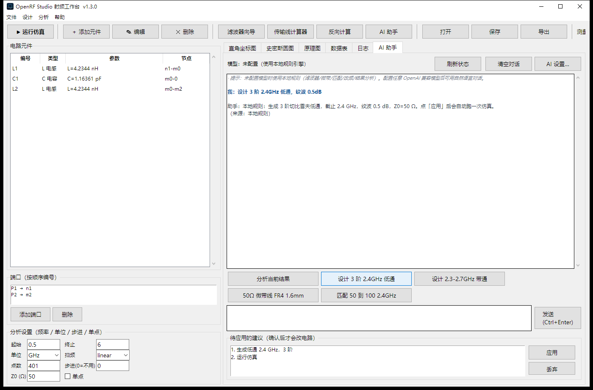
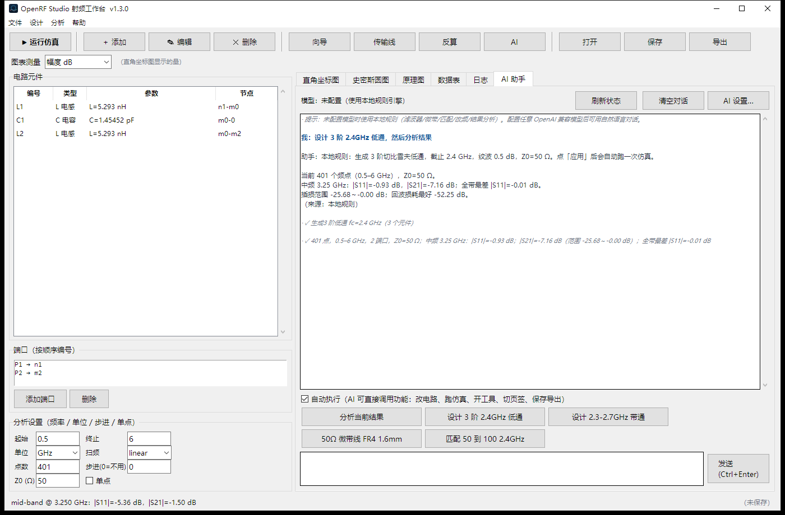

# AI 辅助设计

> v1.3 新增。用自然语言下指令，AI 给出电路修改建议；**模型可自定义**，
> 未配置模型时由本地规则引擎兜底，离线也能用。

---

## 1. 能做什么

| 场景 | 示例说法 |
|---|---|
| 滤波器设计 | "设计 3 阶 2.4GHz 低通，纹波 0.5dB" / "2.3–2.7GHz 带通 5 阶" |
| 传输线计算 | "50Ω 微带线 FR4 1.6mm" / "Z0=75，εr=3.55，h=0.813" |
| 阻抗匹配 | "匹配 50 到 100，2.4GHz" |
| 改频微调 | "把这台滤波器改频到 2.5GHz" |
| 巴伦（balun）设计 | "设计 1:4 巴伦（balun）2.4GHz 并测试" |
| 结果解读 | "分析一下当前结果" / "为什么阻带不够深" |
| 任意自然语言 | 需配置模型；模型会结合当前电路与最近一次仿真给建议 |

**两种模式**：

* **自动执行（默认）**：勾选「自动执行」后，AI 直接调用软件功能——改电路、跑仿真、
  跑计算器、开工具、切页签、保存/导出；执行结果回流给它做下一步判断（最多 3 轮），
  最后给出分析与建议。每一步执行都会在对话里打勾显示（✓），可追溯。
* **人工确认**：取消勾选后，AI 只产出「待应用的建议」，点「应用」才生效，点「丢弃」忽略。

## 1.1 AI 能调用哪些功能

| 类别 | 能力 |
|---|---|
| 电路 | 清空 / 增删改元件 / 生成滤波器 / 设 Z0 / 设扫频 |
| 仿真 | 立即扫频并读取 S 参数、插损、回波、群时延 |
| 计算器 | 微带线、带状线、同轴、LC 谐振、改频、L 型匹配、S11 反算 |
| 界面 | 切换页签（直角坐标图/史密斯/原理图/数据表/日志/AI）、打开工具对话框 |
| 文件 | 保存工程、导出 Touchstone（默认写到 ai_output/） |
| 报告 | 汇总当前结果指标 |

多轮流程：需求 → 模型给动作 → 执行器执行 → 结果回流 → 模型分析/再动作 → …（最多 3 轮）。
这是基于 JSON 动作协议的函数调用，不依赖各家模型的 tool-calling 差异，本地模型同样可用。

---

## 2. 自定义模型

「帮助 → AI 设置（自定义模型）」，或在 AI 页签点「AI 设置…」。

| 字段 | 说明 |
|---|---|
| 接口地址 base_url | 兼容 `/v1/chat/completions` 的地址，例如 `https://api.openai.com/v1` |
| 模型名 model | 例如 `gpt-4o-mini`、`deepseek-chat`、`qwen-plus`、`llama3.1` |
| API Key | 本地模型可留空 |
| 温度 / 最大 token / 超时 | 按需调整；默认 0.3 / 1200 / 60s |

常见配置：

| 服务 | base_url 示例 | 模型名示例 |
|---|---|---|
| OpenAI | `https://api.openai.com/v1` | `gpt-4o-mini` |
| DeepSeek | `https://api.deepseek.com/v1` | `deepseek-chat` |
| 通义千问（兼容模式） | `https://dashscope.aliyuncs.com/compatible-mode/v1` | `qwen-plus` |
| Moonshot | `https://api.moonshot.cn/v1` | `moonshot-v1-8k` |
| 智谱 | `https://open.bigmodel.cn/api/paas/v4` | `glm-4-flash` |
| 本地 Ollama | `http://127.0.0.1:11434/v1` | `llama3.1` |
| 本地 LM Studio | `http://127.0.0.1:1234/v1` | 模型列表里的名字 |
| vLLM / one-api | 对应地址 | 对应模型 |

点「获取模型列表」可拉取 `/v1/models`；点「测试连接」验证连通与鉴权。

**自定义请求头**：配置文件的 `extra` 字段支持 `header:名字` 键，例如
`{"header:X-Org": "team-a"}`，会作为额外请求头发出。

---

## 3. 隐私与安全

* 密钥只保存在本机用户配置目录（`%APPDATA%/OpenRF_Studio/ai.json`），界面只显示掩码；
* 只在你点击「发送」时才发起网络请求；请求发往**你自己填的端点**，软件不含任何遥测或中转服务；
* 请求内容 = 当前电路摘要（元件/端口/分析设置/最近结果）+ 你的提问，**不包含密钥**；
* 用公开/第三方模型时，请自行确认其数据使用条款；涉密电路建议用本地模型（Ollama / LM Studio / vLLM）。

---

## 4. 未配置模型时（本地规则）

本地规则引擎不需要网络与密钥，能用固定句式完成：低通/带通设计、微带线宽、L 型匹配、改频、结果分析。
识别中文与英文关键词，频率支持 GHz / MHz / kHz（如 `900MHz`），并自动在回复里给出关键数值。

限制：不理解自由发挥的问题；需要开放对话时再配置模型。

---

## 5. 动作协议（供二次开发）

模型必须只输出一个 JSON 对象：

    {"reply": "给用户的中文说明", "actions": [ ... ]}

支持的动作：

| op | 字段 | 作用 |
|---|---|---|
| `set_z0` | value | 设参考阻抗 |
| `set_analysis` | start_ghz / stop_ghz / points / sweep / single | 改扫频设置 |
| `clear` | — | 清空元件 |
| `add` | id / kind / nodes / params | 新增元件（kind ∈ R/L/C/TL/MS/COAX） |
| `update` | id / params | 改元件参数 |
| `delete` | id | 删元件 |
| `build_filter` | topo / order / fc_ghz 或 f1_ghz+f2_ghz / z0 / ripple_db / kind | 生成 LC 梯形滤波器 |
| `run` | — | 应用后跑一次仿真 |

校验规则：白名单 op/kind/参数键；数值必须有限，元件值必须为正；一次最多 40 个动作、20 个新增；
**任何一条动作校验失败就整条丢弃**，不会把非法参数写进电路。

---

## 6. 实现与扩展

| 文件 | 职责 |
|---|---|
| `app/ai/config.py` | 配置读写、环境变量覆盖、密钥掩码 |
| `app/ai/client.py` | OpenAI 兼容客户端（urllib，无第三方依赖） |
| `app/ai/assistant.py` | 上下文构造、提示词、JSON 解析、本地规则 |
| `app/ai/actions.py` | 动作校验与应用 |
| `app/ui/ai_panel.py` | 对话界面、待应用列表、设置对话框 |

环境变量：`OPENRF_AI_BASE_URL` / `OPENRF_AI_MODEL` / `OPENRF_AI_KEY` /
`OPENRF_AI_TIMEOUT` / `OPENRF_AI_CONFIG`（配置文件路径）/ `OPENRF_AI_DISABLE=1`（强制本地规则）。