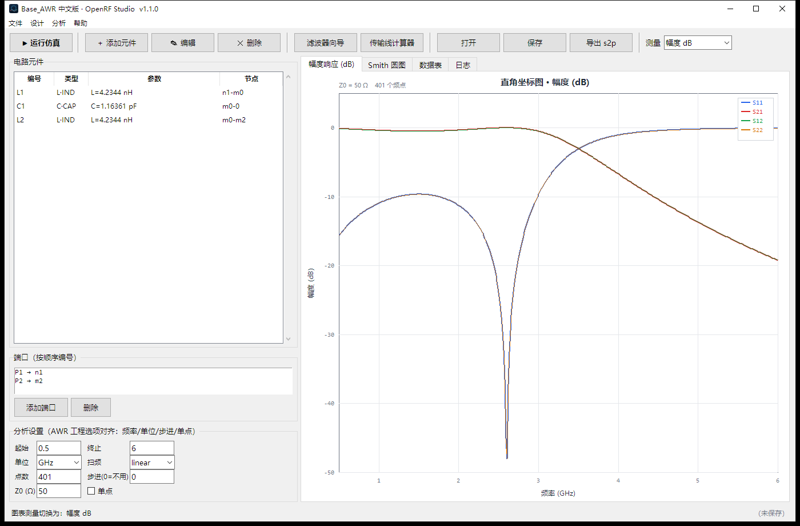
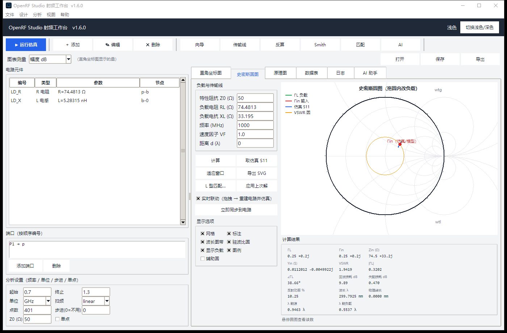
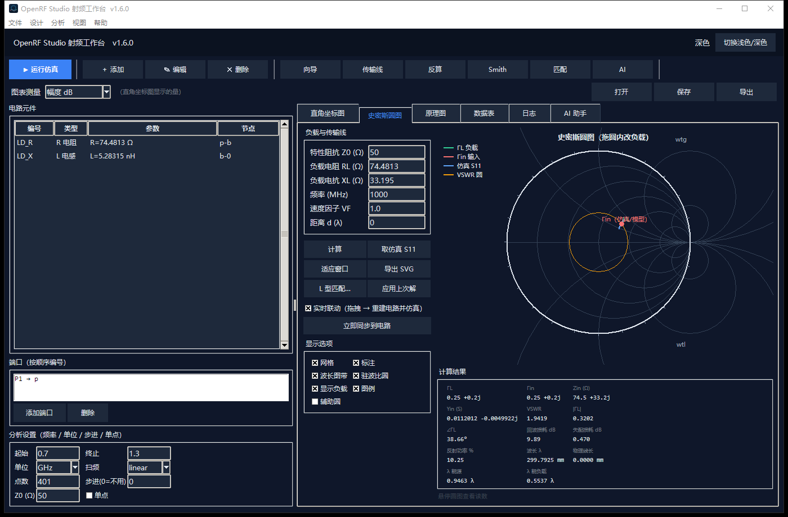
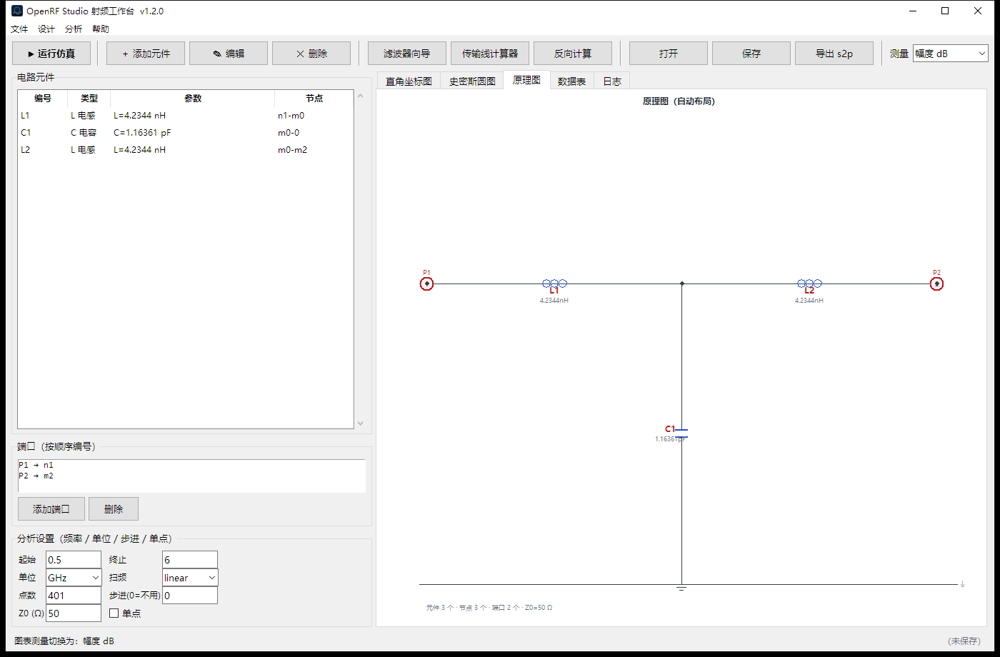
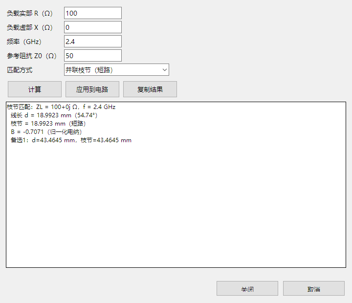
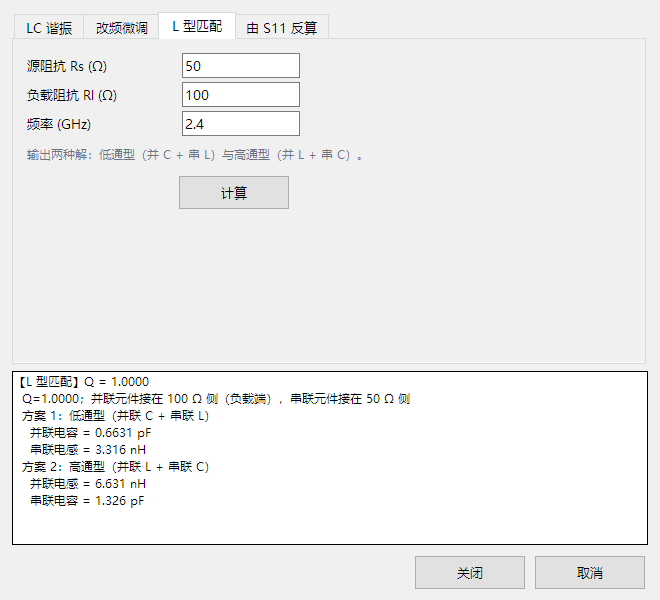
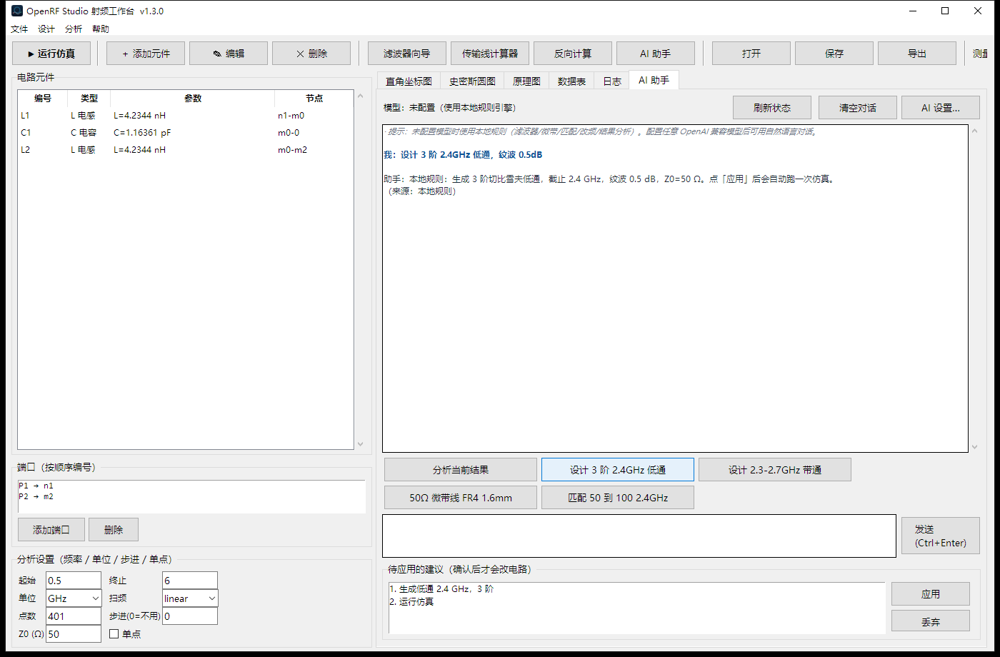

# 用户手册 · OpenRF Studio 射频工作台

> 适用版本：v1.2　｜　界面语言：简体中文　｜　运行环境：Windows 10/11

---

## 1. 启动

| 方式 | 操作 |
|---|---|
| **免安装 exe（推荐）** | 双击 dist/OpenRF_Studio/OpenRF_Studio.exe |
| 源码运行 | python run.py 或双击 启动.cmd |
| 无界面批处理 | python -m app.cli run 工程.json -o out.s2p |

启动后自动打开内置示例（3 阶 3 GHz 低通）并完成一次仿真。

---

## 2. 界面导览

左侧是电路（元件表 / 端口 / 分析设置），右侧是结果（直角坐标图 / 史密斯圆图 / 原理图 / 数据表 / 日志），底部状态栏显示最后一次仿真的关键数字。

---

## 3. 五分钟上手：2.4 GHz 带通滤波器

1. 工具栏点「滤波器向导」；
2. 选带通、chebyshev、阶数 3、下边频 2.3 GHz、上边频 2.7 GHz、纹波 0.5 dB、Z0 50 Ω；
3. 点「生成电路」，自动生成 6 个元件并仿真；
4. 直角坐标图看通带/阻带，史密斯圆图看匹配，原理图看拓扑；
5. Ctrl+S 保存，或「导出 s2p」导出 Touchstone。

实测：中心 2.5 GHz 插损 -0.01 dB，S11 -27.6 dB，1.5 GHz 抑制 -52 dB。

---

## 4. 元件参考

节点名任意；地固定写 0；并联元件把「节点 2」填 0。

| 代号 | 元件 | 参数 | 说明 |
|---|---|---|---|
| R | 电阻 | r (Ω) | 理想电阻 |
| L | 电感 | l (nH) | 理想电感 |
| C | 电容 | c (pF) | 理想电容 |
| TL | 理想传输线 | z0 / er / len / loss | er 填有效介电常数（空气线 = 1） |
| MS | 微带线 | w / h / er / len / loss | 每个频点重算 Z0 与 εeff |
| CX | 同轴线 | d_in / d_out / er / len | TEM 精确解析式 |

元件表「类型」列显示"代号 + 中文名"（如 MS 微带线）。

---

## 5. 端口与分析设置

| 字段 | 含义 | 建议 |
|---|---|---|
| 端口 | 端口绑定的节点，顺序即 S 参数编号 | 双端口：P1 接 n1，P2 接 n2 |
| 起始 / 终止 | 扫频范围，单位由「单位」决定 | 覆盖关心频段的 0.3–3 倍 |
| 单位 | GHz / MHz / kHz，切换时数值自动换算 | 低频用 MHz/kHz 不易填错 |
| 点数 | 采样点数 | 401–1001 |
| 步进 | 填了用步进（0 = 用点数） | 等间隔扫描 |
| 单点 | 只算起始频点 | 快速看一个点 |
| Z0 | 端口参考阻抗 | 常用 50，电视 75 |
| 扫频 | linear / log | 宽频段看趋势用 log |

---

## 6. 结果阅读

### 6.1 直角坐标图
工具栏「测量」可切换：幅度 dB、驻波比 VSWR（显示上限 20）、群时延 ns。

### 6.2 史密斯圆图
外圆 |Γ|=1；蓝线为 S11 轨迹，红点标注频点（GHz）；靠近圆心即匹配好。

### 6.2.1 Smith 工具（新增）

「Smith 工具」页签是可交互的圆图计算器：左侧填 Z0 / 负载 RL、XL / 频率 / 速度因子 / 距离 d(λ)，右侧圆图显示 ΓL 与观察点 Γin，并叠加当前仿真的 S11 轨迹。

- 圆内点击/拖动 = 移动观察点；圆外拖动 = 平移；滚轮 = 缩放；双击 = 复位；悬停看读数。
- 下方读数含 Zin/Yin、VSWR、回波损耗、失配损耗、反射功率、波长与物理线长。
- 「取仿真 S11」把当前电路在指定频点的输入阻抗当作负载；「L 型匹配…」给出最多 4 个解，「应用到电路」会插到 P1 前并重新仿真验证。
- 「导出 SVG」保存矢量圆图；参数随工程 JSON 一起保存。

详细说明见 [Smith工具.md](Smith工具.md)。

### 6.1.1 默认单位与频率范围（v2.4）

默认频率单位为 **MHz**，默认扫频 **0.1 Hz – 30 MHz**（对数扫频，401 点）。
起始可填 1e-7（MHz）即 0.1 Hz；新建工程与示例工程都采用这套默认值。

### 6.2.0 鼠标定位读数（v2.2）

在「直角坐标图」上移动鼠标即出**红色十字线与定位框**，实时显示该频点的
f、S11、S21、VSWR、群时延与 ∠S11；单击钉住、双击或再次单击清除。

### 6.2.1 动态播放（v2.0）

点「▶ 运行仿真」后会自动进入**运动模式**：光标沿频率轴扫过，幅度图与圆图同步标点，
状态栏实时显示该频点的 |S11|、|S21|、VSWR。第二行有「▶ 播放 / ■ 停止 / 速度 /
运行后自动播放」；也可手动点「▶ 播放」重放。速度可选 1/5/10/20/50 点每帧。

### 6.2.2 归一化显示与线阻抗

* 圆图工作台勾选「归一化显示（Z/Y 除以 Z0）」，读数切换为归一化阻抗/导纳；
* 设计 → 线阻抗计算：输入 Z0/ZL/线长 d(λ)/频率，给出 Zin、归一化 zin、VSWR、回损、
  失配损耗、波长与物理线长、电长度。

### 6.2.3 史密斯图 ↔ 直角坐标图实时同步（v2.4）

在史密斯圆图里改频率/负载（勾选实时联动时拖拽也生效）会：① 自动把扫频带设到该频点附近；
② 重新仿真；③ 在直角坐标图对应频率处打出红色定位十字线并显示读数——两图始终同一频点。

### 6.3 史密斯圆图工作台（v1.6 全新界面）

原「史密斯圆图」与「Smith 工具」已合并为**一个**「史密斯圆图」页签：

* **自动叠加**当前仿真的 S11 轨迹，仿真后即时刷新；
* **拖拽实时联动**（默认开）：在圆内按住拖动，拖到的反射系数当作负载 Γ → 自动换算 ZL →
  **重建「端口—负载」电路并立即仿真**（180 ms 防抖）；右侧读数（ΓL/Γin/Zin/Yin/VSWR/
  回波损耗/失配损耗/反射功率/波长/线长）同步更新；
* 拖动圆外为平移视图，滚轮缩放，双击复位；
* 左侧可关掉「实时联动」，改用「立即同步到电路」手动触发；
* 「L 型匹配…」给出最多 4 个解，「应用上次解」直接落到电路并复算；
* 「导出 SVG」保存当前圆图。

### 6.4 原理图（v1.2 新增）
按当前网表自动布局：端口在两端，串联元件画在连线上，并联元件向下接到地母线，符号旁标编号与数值。修改元件或运行仿真后自动重画。

### 6.5 数据表 / 日志
数据表给出每频点的幅度与相位；日志记录操作与仿真摘要。

---

## 7. 设计工具

### 7.1 滤波器向导
低通：填阶数、截止频率、纹波、Z0，生成串 L / 并 C 交替的梯形网络（奇数阶串 L 起，偶数阶并 C 起）。
带通：填上下边频，按 f0 = √(f1·f2)、FBW = (f2−f1)/f0 做低通到带通变换，串/并支路展开成 LC。

### 7.2 传输线计算器
三个页签：微带线 / 带状线 / 同轴。顶部可切长度单位（mm/mil）与频率单位（GHz/MHz）。
每个页签都有「由 Z0 算尺寸」「分析（尺寸→Z0）」「λ/4 长度」。微带页还提供基板预设
（FR-4、RO4350B、RO4003C、氧化铝、空气）。

### 7.3 匹配计算器（v1.4 新增）

工具栏「匹配」或 设计 → 匹配计算器。输入负载 ZL=R+jX、频率、Z0，选择：

* 并联枝节（短路/开路）
* 串联枝节（短路/开路）
* L 型匹配（低通型/高通型）

点「计算」得到线长 d、枝节长度与归一化电纳/电抗；点「应用到电路」会生成
「端口—传输线—负载 + 枝节」网络，自动把扫频设到中心频率附近并重新仿真。
纯阻负载回代 S11 可达 −140 dB 量级。

### 7.4 S2P 元件（v1.4 新增）

设计 → 导入 S2P 元件：选择一个 2 端口 Touchstone 文件（.s2p），填两个节点即可。
元件按频点线性插值 S 参数并转成 Y 参与全网求解；文件路径保存在工程里，
频率范围会自动带到分析设置。3 端口及以上会明确报错（当前只支持 2 端口）。

### 7.5 反向计算（v1.2 新增）

四个页签，解决"现有元件要改成多少"的问题：

| 页签 | 输入 | 输出 |
|---|---|---|
| LC 谐振 | 频率、L、C 中任意两个 | 第三个的值；三个都填则给出实际谐振频率与偏差 |
| 改频微调 | 现有 L、C、目标频率、保留哪个元件 | 需要替换的元件新值与调整量 |
| L 型匹配 | 源阻抗、负载阻抗、频率 | 低通型与高通型两套解，并提示并联件接哪一侧 |
| 由 S11 反算 | S11 的幅度与相位、频率 | 输入阻抗、VSWR、可用的串联/并联电抗（换算成 L 或 C） |

使用建议：
* 只想把谐振频率从 f1 挪到 f2，且只能换一个元件 → 用「改频微调」，它会给出 ΔC 或 ΔL；
* 源和负载阻抗不同（例如 50Ω 与 100Ω）→ 用「L 型匹配」，两套解任选，低通型通常更常用；
* 实测/仿真得到一个 S11，想知道"再并一个多大电容能调回来" → 用「由 S11 反算」。

---

### 7.4 AI 助手（v1.3 新增）

「AI 助手」页签可以自然语言下指令，例如「设计 3 阶 2.4GHz 低通」「50Ω 微带线 FR4 1.6mm」
「匹配 50 到 100」「改频到 2.5GHz」「分析当前结果」。

* **自动执行（默认开）**：AI 可直接改电路、跑仿真、调计算器、开工具、切页签、保存导出，
  执行结果回流后自动分析；对话里会用 ✓ 列出每一步执行。取消勾选则改为「待应用」人工确认；
* 模型可自定义：帮助 → AI 设置，填 base_url / 模型名 / 密钥（支持本地 Ollama、LM Studio 等）；
* 未配置模型时用本地规则引擎，离线也能完成上面这些常用操作；
* 密钥只存本机；请求只发往你自己填的端点。详见 docs/AI辅助设计.md。

## 8. 文件与数据交换

### 8.1 工程文件（JSON）

字段：name（名称）、freq_unit（显示单位）、len_unit、analysis（start_ghz / stop_ghz /
points / sweep / step_ghz / single）、network（z0 / components / ports）。
元件单位固定为 nH、pF、mm、Ω，可直接手改。

### 8.2 Touchstone（.sNp）
支持 1..N 端口，格式 MA / DB / RI，频率单位 Hz / kHz / MHz / GHz。
导入只作为灰色虚线参考，不会替换当前电路；不支持噪声参数块与混合模 S 参数（会明确报错）。

---

## 9. 快捷键

| 快捷键 | 功能 |
|---|---|
| F5 | 运行仿真 |
| F1 | 使用说明 |
| Ctrl+S / Ctrl+O | 保存 / 打开 |
| Delete | 删除选中元件 |
| 双击元件行 | 编辑该元件 |

---

## 10. 常见问题

| 现象 | 处理 |
|---|---|
| 图上"尚无数据" | 先点运行仿真，并确认端口已定义 |
| 报"矩阵奇异" | 有悬空节点：每个节点至少连到两个元件或端口 |
| 结果与预期差很多 | 检查单位（nH/pF/mm）、εr 是否填有效值、端口节点是否正确 |
| 微带线与理想线不一致 | 正常：微带 Z0/εeff 随频率变化（色散） |
| 导出的 s2p 打不开 | 后缀要与端口数一致（xxx.s2p = 2 端口） |
| 原理图太挤 | 节点多时自动分层，拉大窗口后切换页签即可重绘 |
| 中文显示成方框 | 系统缺"微软雅黑"字体 |
| AI 回复「模型调用失败」 | 会自动回落本地规则；检查 base_url/模型名/密钥与网络 |
| AI 答非所问 | 换更强的模型，或在提问里给出频率、阶数、阻抗等具体数值 |

---

## 11. 性能参考

| 场景 | 规模 | 耗时 |
|---|---|---|
| 2 端口 LC 低通 | 401 点 | < 0.1 s |
| 3 端口功分器 | 201 点 | < 0.15 s |
| 带通（6 元件） | 601 点 | < 0.2 s |

复杂度 O(频点 × 节点数³)；百级节点以内流畅。

---

## 12. 边界与免责

准静态/集总近似，不含全波效应、封装寄生、版图耦合、工艺涨落；不提供器件模型库。
结果供设计参考，量产前必须用全波仿真与实测验证。与任何商业 EDA 软件无关联。